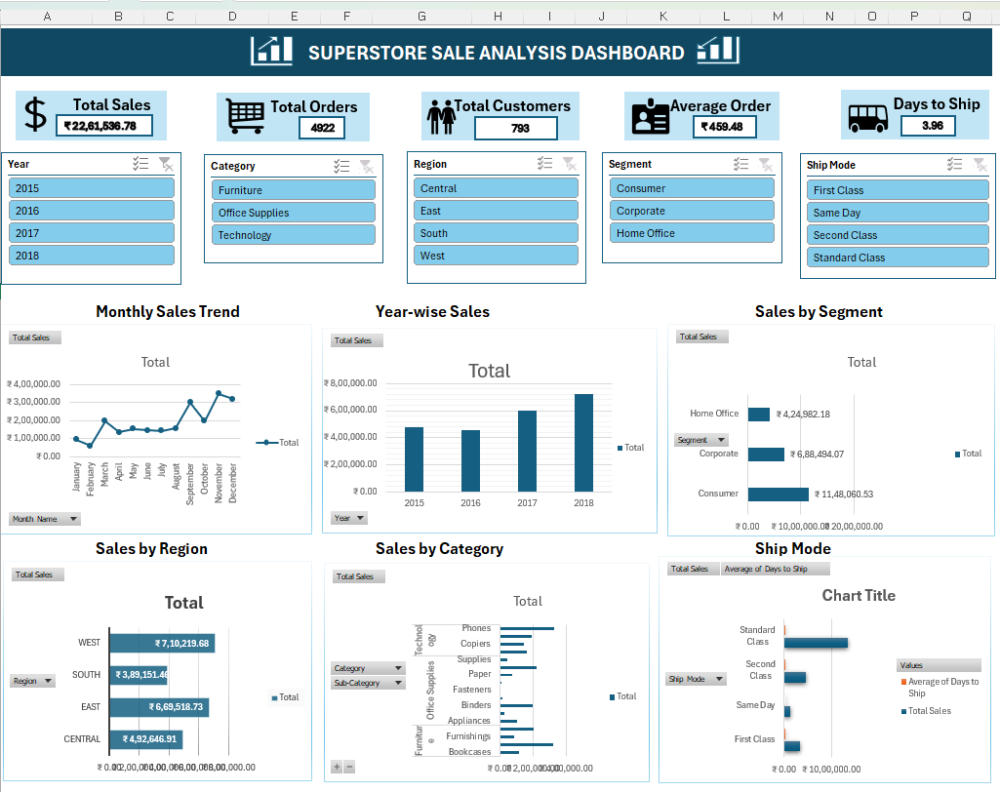

# Superstore Sales Analysis | Microsoft Excel 365

An end-to-end sales analysis project built in Microsoft Excel 365. The workbook transforms raw Superstore transaction data into cleaned, analysis-ready data, KPI summaries, PivotTable-based analysis, an interactive dashboard, and business recommendations.

## Project Overview

The purpose of this project is to explore sales performance across time, regions, product categories, customer segments, and shipping modes. The analysis is designed to support business users in identifying sales patterns and areas that may deserve further attention.

## Business Objectives

- Summarize overall sales performance using key performance indicators (KPIs).
- Compare sales across years, months, regions, categories, and customer segments.
- Examine shipping-mode performance and average shipping duration.
- Identify high-performing products, customers, and states.
- Present findings through an interactive Excel dashboard and translate them into practical recommendations.

## Dataset

The workbook contains **9,800 transaction records** and 18 source fields, including:

- Order details: Row ID, Order ID, Order Date, Ship Date, and Ship Mode
- Customer details: Customer ID, Customer Name, and Segment
- Location details: Country, City, State, Postal Code, and Region
- Product details: Product ID, Category, Sub-Category, and Product Name
- Sales: Sales

The `Cleaned_Data` worksheet adds helper fields for cleaned order and ship dates, year, month number, month name, quarter, and days to ship.

## Tools and Excel Features

- Microsoft Excel 365
- Excel formulas and calculated helper columns
- Excel Tables
- PivotTables and PivotCharts
- Interactive slicers
- Charts and KPI cards
- Microsoft Copilot / generative AI features as part of the documented GenAI-in-Excel activity

## Workbook Structure

| Worksheet | Purpose |
|---|---|
| `Raw_Data` | Original transaction-level data |
| `Cleaned_Data` | Analysis-ready data with date and shipping helper columns |
| `Analysis` | KPI calculations and summary analysis |
| `Pivot Tables` | Nine PivotTable analyses covering sales trends, regions, categories, segments, shipping modes, customers, products, and states |
| `Interactive Dashboards` | Six charts and interactive slicers for exploring sales performance |
| `Findings & Recommendations` | Key business insights and recommendations based on the analysis |

## Key Performance Indicators

The workbook reports the following overall metrics:

| KPI | Result |
|---|---:|
| Total Sales | 2,261,536.78 |
| Total Orders | 4,922 |
| Total Customers | 793 |
| Average Order Value | 459.48 |
| Average Days to Ship | 3.96 days |

*Values are reported as calculated in the workbook. Sales and monetary KPIs use the dataset's currency units.*

## Analysis Highlights

- **Annual performance:** 2018 recorded the highest annual sales at 722,052.02.
- **Monthly performance:** November recorded the highest monthly sales across the four-year period, at 350,161.71.
- **Regional performance:** The West region led with sales of 710,219.68.
- **Category performance:** Technology was the highest-selling category at 827,455.87.
- **Customer segment:** Consumer generated the highest sales at 1,148,060.53.
- **Shipping mode:** Standard Class generated the highest sales among the shipping modes.
- **State performance:** California recorded the highest state-level sales at 446,306.46.
- **Top product:** Canon imageCLASS 2200 Advanced Copier was the top product by sales in the workbook's Top 10 Products analysis.

## Interactive Dashboard

The dashboard contains six charts covering:

1. Monthly sales trend
2. Year-wise sales
3. Sales by customer segment
4. Sales by region
5. Sales by category
6. Sales by shipping mode

Slicers allow users to interactively filter the dashboard. The dashboard is intended to provide a concise view of performance without requiring users to navigate each analysis table.

### Dashboard Preview

## Business Recommendations

- **Inventory planning:** Monitor stock availability for high-performing products and product areas, including Phones, Chairs, and Technology products.
- **Seasonal planning:** Review sales patterns ahead of stronger months, particularly September, November, and December, and plan inventory and promotions accordingly.
- **Regional strategy:** Study performance in the West and East regions and investigate opportunities to improve results in the Central and South regions.
- **Customer retention:** Consider loyalty and engagement initiatives for the Consumer segment, which contributes the largest share of sales.
- **Shipping operations:** Review shipping-mode mix and delivery duration to understand operational performance. The dataset does not provide shipping costs, so this analysis does not claim a quantified shipping-cost saving.

## GenAI in Excel

The project includes a GenAI-in-Excel activity using Microsoft Excel 365 and available Copilot functionality. Generative AI was treated as an assistance feature within the analysis workflow; workbook calculations, outputs, and business conclusions should be checked against the underlying data before being used for decisions.

## How to Use

1. Download the Excel workbook from this repository.
2. Open it in Microsoft Excel 365 for the best compatibility with the workbook's interactive features.
3. Review `Raw_Data` and `Cleaned_Data` to understand the source fields and helper columns.
4. Explore the `Analysis` and `Pivot Tables` worksheets for the calculations and supporting summaries.
5. Open `Interactive Dashboards` and use the slicers to filter the charts.
6. Read `Findings & Recommendations` for the main conclusions drawn from the analysis.

## Project Files

- **Excel Workbook:** `Superstore_Sales_Analysis (1).xlsx`
- **Project Documentation:** `README.md`
- **Dashboard Screenshot:** `SuperstoreAnalysis_dashboard.png`

## Limitations

- The analysis is based on the fields available in the supplied dataset.
- Shipping costs and profit are not included in the KPI summary described here; recommendations should not be interpreted as quantified profit or cost-saving estimates.
- Findings describe patterns in the historical data and do not establish causation or guarantee future performance.

## Conclusion

This project demonstrates the use of Microsoft Excel 365 for data preparation, formula-based analysis, KPI reporting, PivotTable exploration, interactive dashboard development, and communicating business insights. It provides a consolidated view of Superstore sales performance and a foundation for further analysis.
